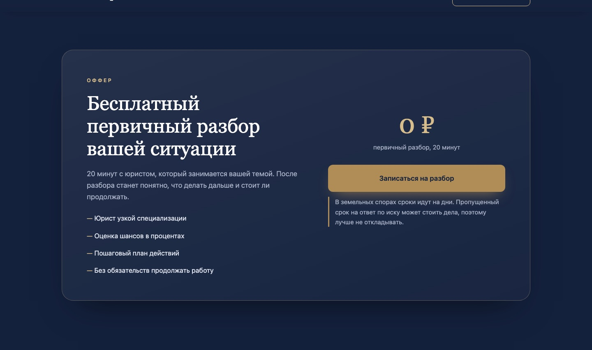
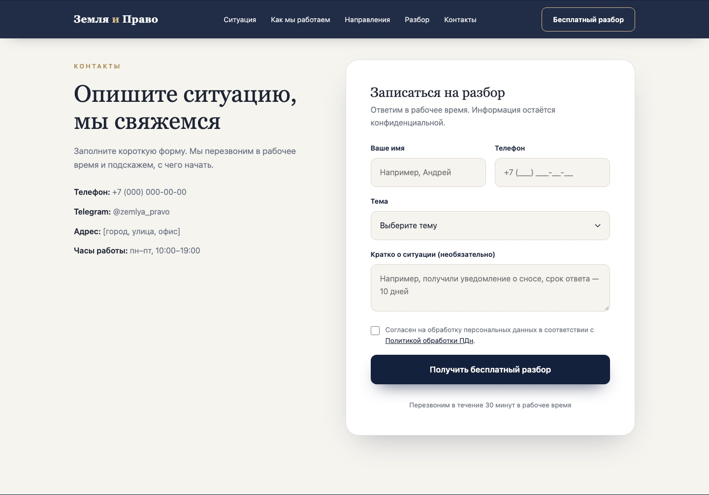

# «Земля и Право» — лендинг юриста по земельным спорам

Одностраничный сайт для узкопрофильных юристов по земельным спорам, сделкам с недвижимостью и сопровождению строительства. Главный оффер — **бесплатный разбор ситуации за 20 минут**, фиксированная цена и работа с 2014 года.

## Скриншоты







## Задача

Юристы работают в узкой нише — земельные споры, недвижимость и стройка. Нужно было:

- сразу отделить себя от «юристов на все случаи»;
- объяснить, с чем приходят и что будет на разборе;
- снять страх «приду и мне начнут продавать дорогие услуги»;
- собрать заявку на бесплатный 20-минутный разбор.

## Пользователь

- Собственники земли и домов, у которых хотят отобрать, перекроить участок или признать постройку самостроем.
- Застройщики и девелоперы.
- Владельцы сельхозземель и инвесторы.
- Люди, которые уже устали от «универсальных» юристов и хотят узкого специалиста.

## Что реализовано

- Первый экран с оффером и бесплатным разбором.
- Блоки «Что будет на разборе», «С чем к нам приходят», «Решение», «Кому помогаем», «Оффер», «Контакты».
- Форма заявки: имя, телефон, описание ситуации → отправка в Google Apps Script.
- Адаптив: десктоп, планшет, мобильный.
- Анимации появления блоков при скролле.
- Плавный скролл по якорям и мобильное меню.
- SEO: title, description, Open Graph.

## Стек

- **HTML5** — семантическая разметка.
- **CSS3** — встроенные стили, Grid/Flex, `clamp()`, адаптив.
- **Vanilla JavaScript** — меню, reveal-анимации, отправка формы.
- **Google Fonts** — Playfair Display + Manrope.
- **Google Apps Script** — приём заявок без собственного бэкенда.

## Как запустить

```bash
git clone https://github.com/Inaba1995/zemlya-i-pravo-landing.git
cd zemlya-i-pravo-landing
python3 -m http.server 8000
```

Открыть <http://localhost:8000>. Можно и просто открыть `index.html`.

## Настройка формы

В `index.html` найдите ссылку на `script.google.com` и замените на свой Apps Script Web App. Форма отправляет POST с полями `name`, `phone`, `message`.

## Структура

```
zemlya-i-pravo-landing/
├── index.html          # разметка, стили и скрипты
├── images/             # скриншоты для README
└── README.md
```

## Что можно улучшить

- Вынести стили и скрипты в отдельные файлы.
- Подключить аналитику и цели на отправку формы.
- Добавить страницу с кейсами и ценами.
- Заменить демо-контакты на реальные.
